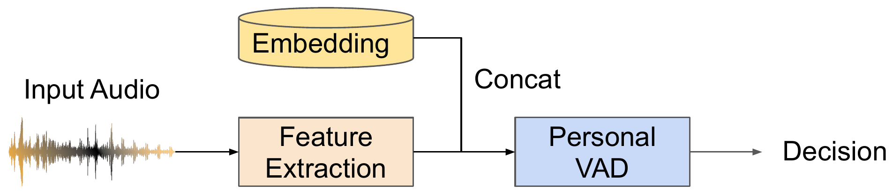
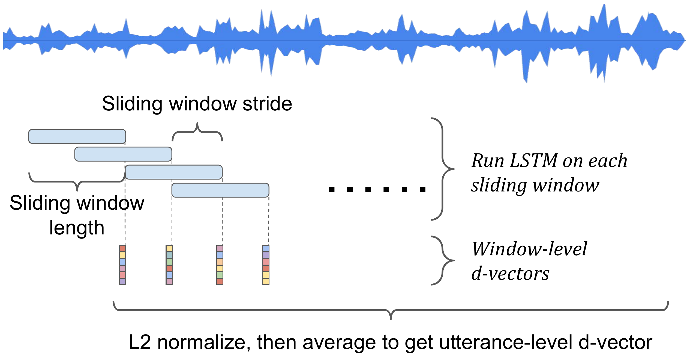
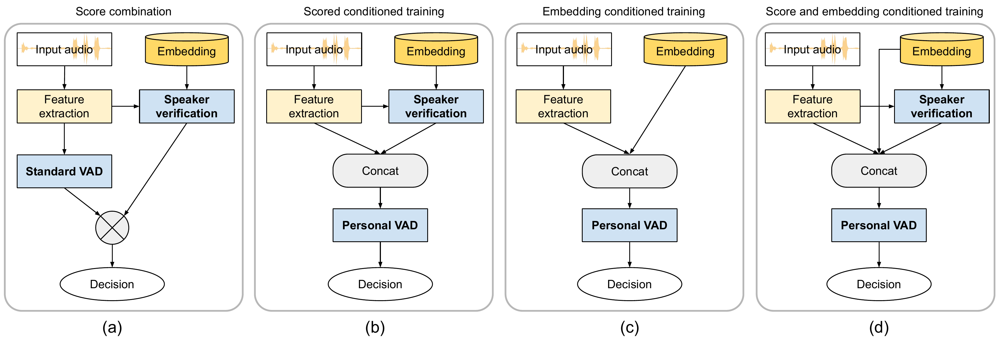
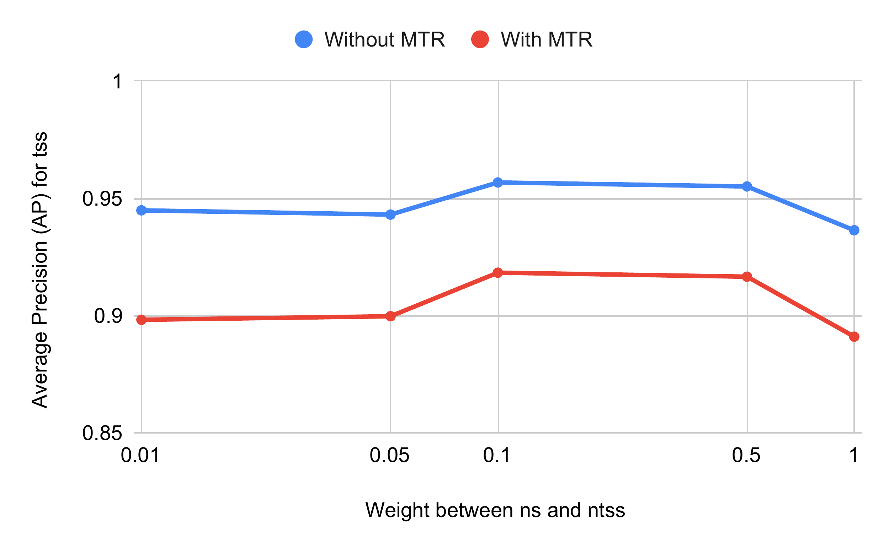
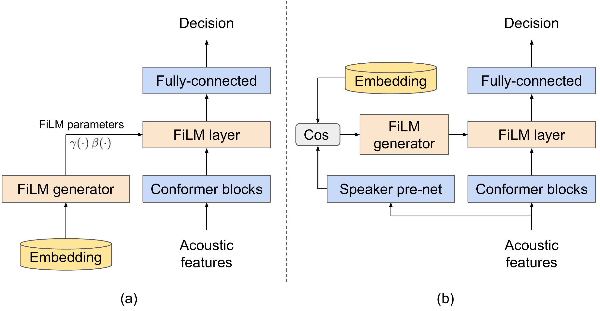

# Personal VAD (Speaker-Conditioned Voice Activity Detection)

[](https://github.com/wq2012/personal_vad/actions/workflows/pythonapp.yml)
[](https://huggingface.co/spaces/wq2012/personal_vad)
[](https://huggingface.co/wq2012/personal-vad-v2-conformer-film-dvector-cos)
[](https://pypi.org/project/personal-vad/)
[](https://pypi.org/project/personal-vad/)
[](https://www.pepy.tech/projects/personal-vad)

**This is not an officially supported Google product.**

## Introduction

This repository provides a standalone, open-source Python reproduction of
**Personal VAD 1.0** and **Personal VAD 2.0** based on the Odyssey 2020 and
Interspeech 2022 papers:

> **Personal VAD: Speaker-Conditioned Voice Activity Detection**
> *Shaojin Ding, Quan Wang, Shuo-yiin Chang, Li Wan, Ignacio Lopez Moreno*
> Paper: [https://arxiv.org/pdf/1908.04284](https://arxiv.org/pdf/1908.04284) | Interactive Demo: [Hugging Face Space (`wq2012/personal_vad`)](https://huggingface.co/spaces/wq2012/personal_vad) | Blog Page: [https://google.github.io/speaker-id/publications/PersonalVAD/](https://google.github.io/speaker-id/publications/PersonalVAD/)

> **Personal VAD 2.0: Optimizing Personal Voice Activity Detection for On-Device Speech Recognition**
> *Shaojin Ding, Rajeev Rikhye, Qiao Liang, Yanzhang He, Quan Wang, Arun Narayanan, Tom O'Malley, Ian McGraw*
> Paper: [https://arxiv.org/pdf/2204.03793](https://arxiv.org/pdf/2204.03793) | Pretrained Models: [Hugging Face Hub (`wq2012`)](https://huggingface.co/wq2012)

> [!NOTE]
> **Open-Source Reproduction Notice**: This library is an independent
> open-source reproduction of the published papers above. It does **not** use
> the original internal codebase used in the papers, which relied on Google's
> proprietary software infrastructure (including internal acoustic frontends,
> proprietary room simulators, a proprietary 4.88M-parameter 3-layer GE2E LSTM
> speaker verification d-vector model trained on vendor-collected datasets,
> and internal streaming on-device ASR evaluation pipelines). Instead, all
> modules, training scripts, evaluation suites, speaker embedding extractors,
> and pretrained checkpoints in this repository are newly implemented from
> scratch using open-source [`lingvo`](https://github.com/tensorflow/lingvo),
> `tensorflow`, and `numpy`/`scipy`, and trained on the open-source 8-language
> **Multilingual LibriSpeech (MLS)** corpus (`de`, `en`, `es`, `fr`, `it`,
> `nl`, `pl`, `pt`).

**Personal VAD** detects frame-level voice activity of a specific **target
speaker** in multi-speaker and noisy acoustic environments, serving as a
lightweight on-device gatekeeper before downstream speech recognition (ASR).
Unlike standard VAD, which classifies each audio frame into two classes
(`Speech` vs. `Silence`), Personal VAD classifies each frame into three classes:

- **`0`: `SPEECH` (`tss`)** — Target Speaker Speech
- **`1`: `SILENCE` (`ns`)** — Non-Speech / Silence
- **`2`: `SPEECH_FROM_NON_TARGET_SPEAKER` (`ntss`)** — Non-Target Speaker Speech

<p align="center">
  
  &nbsp;&nbsp;&nbsp;
  
</p>

---

## Architecture & Features

### 1. Personal VAD 1.0 Conditioning Architectures (`SC`, `ST`, `ET`, `SET`)

<p align="center">
  
</p>

- **`SC` (Score Combination Baseline)**: Runs a standard 2-class VAD and
  frame-level speaker verification independently, rescaling the cosine
  similarity score via online 5th/95th histogram percentiles
  (`OnlinePercentileValue`) to split speech probability into `tss` and `ntss`.
- **`ST` (Score-Conditioned Training)**: Concatenates 40-D log-Mel features and
  frame-level speaker verification cosine similarity `[x_t, s_t]` (41-D input)
  into a 2-layer 64-unit unidirectional LSTM.
- **`ET` (Embedding-Conditioned Training)**: Concatenates 40-D log-Mel features
  and the 256-D enrolled target speaker d-vector `[x_t, e_target]` (296-D input)
  into a 2-layer 64-unit unidirectional LSTM (`129,795` parameters, `265.4 KB`
  stateful quantized TFLite), eliminating the runtime speaker verification
  network.
- **`SET` (Score and Embedding Conditioned Training)**: Concatenates acoustic
  features, target d-vector, and frame-level cosine score
  `[x_t, e_target, s_t]` (297-D input).
- **Weighted Pairwise Loss (`WPL`)**: Prioritizes `<tss, ns>` and `<tss, ntss>`
  decision boundaries (`weight = 1.0`) over `<ns, ntss>` (`weight = 0.1`).

<p align="center">
  
</p>

### 2. Personal VAD 2.0 Conformer, FiLM Modulation & Speaker Pre-Net (`B1`, `B2`, `B0`, `E0`, `E1`, `E2`, `E3`, `E4`, `E5`)

<p align="center">
  
</p>

- **Stacked Log-Mel Acoustic Frontend**: Extracts 128-dimensional log-Mel
  filterbank energies (32ms window, 10ms step), stacks 4 contiguous frames
  (3 left-context frames + current frame = 512-D), and subsamples by a factor
  of 3 (30ms output frame step).
- **Causal Streaming Conformer Backbone**: 4-layer causal Conformer
  (`model_dim=64`, `num_heads=8`, `left_context=31`, `right_context=0`,
  depthwise conv `kernel_size=7`, `ffn_multiplier=8`), supporting both
  full-sequence training and stateful frame-by-frame streaming inference
  (`stream_step`) with explicit recurrent state inputs/outputs in `.tflite`.
- **Advanced Speaker Conditioning**:
  - `FILM_DVECTOR` (**Architecture E1**): Feature-wise Linear Modulation (FiLM)
    after the Conformer backbone using affine scale and shift parameters
    generated from the target speaker d-vector `e_target`.
  - `FILM_COS` (**Architecture E2**): A 2-layer Conformer **Speaker Pre-Net**
    predicts frame-level speaker embeddings `e_prenet`, computes cosine
    similarity `s_t = cos(e_prenet, e_target)`, and modulates the main
    Conformer output via FiLM.
  - `FILM_DVECTOR_COS` (**Architecture E3 / E4**): Concatenates both
    `[e_target, s_t]` and feeds the combined vector into the FiLM generator.
- **Unified Enrolled & Enrollment-Less Training (Algorithm 1, Architecture E5)**:
  During training, with probability `p_0 = 0.2`, replaces `e_target` with a
  zero vector `0` and maps `ntss` labels to `tss`, allowing a single on-device
  model to operate as both a speaker-conditioned Personal VAD and an
  enrollment-less Standard VAD.

### 3. Speaker Embedding (`d-vector`) Extractor Design & Transparency (`speaker_subspace.npz`)

In the original Personal VAD 1.0 and 2.0 papers, target speaker embeddings
(`e_target`) and frame-level verification scores (`s_t`) were extracted using
Google's internal 3-layer LSTM speaker verification model (`4.88M` parameters)
trained with Generalized End-to-End (`GE2E`) loss ([Wan et al., ICASSP 2018](https://arxiv.org/pdf/1710.10467))
on proprietary vendor-collected datasets across 8 languages.

Because that internal speaker verification model and its training corpora are
proprietary—and to keep this open-source package 100% self-contained in pure
TensorFlow/NumPy with zero external PyTorch/SpeechBrain/JAX runtime
dependencies—**we trained our own lightweight, open-set 256-D speaker embedding
extractor (`OpenSetSpeakerSubspace`, serialized as `speaker_subspace.npz`, ~370 KB)
from scratch on the 98 training speakers (`1,159` utterances) of the 8-language
Multilingual LibriSpeech (MLS) dataset**:

1. **Multi-Resolution Voiced Acoustic Summary (360-D)**:
   - Over voiced speech frames (or over a strictly causal 31-frame / ~310 ms
     sliding window when computing frame-level embeddings `e_t` and cosine
     scores `s_t` for Personal VAD 1.0 `SC`, `ST`, and `SET`), the extractor
     computes a 360-dimensional acoustic statistic vector combining 40-D log-Mel
     `[mean, std, 10th-percentile, 90th-percentile, delta_std]` (200-D) with
     high-resolution 80-D log-Mel `[mean, std]` (160-D), while the Personal VAD
     network's acoustic input `x_t` remains 100% pure log-Mel filterbank
     energies.
2. **Regularized LDA + WCCN + Orthogonal PCA Subspace Projection (256-D)**:
   - Fitted strictly on the **98 MLS training speakers** (`1,159` utterances
     across `de`, `en`, `es`, `fr`, `it`, `nl`, `pl`, `pt`), it standardizes
     the 360-D summary vector, solves the regularized **Linear Discriminant
     Analysis (LDA)** generalized eigenvalue problem between inter-speaker and
     intra-speaker scatter matrices, applies **Within-Class Covariance
     Normalization (WCCN)**, completes the orthogonal basis to 256 dimensions
     via PCA on the residual subspace, adds a fixed positive-cone offset on
     coordinate 255, and L2-normalizes the resulting 256-D speaker embedding
     (`||e||_2 = 1`).
3. **Open-Set Unseen-Speaker Verification Accuracy**:
   - Validated on **16 held-out unseen development speakers** (`192` utterances),
     `speaker_subspace.npz` achieves an open-set speaker verification
     **ROC-AUC of `0.9579`** (mean positive cosine `0.5669` vs. negative
     `-0.0697`).
   - Evaluated on the **40 held-out unseen test speakers** (`480` utterances:
     `120` enrollment + `360` evaluation utterances across 8 languages, zero
     speaker overlap with training or dev), `speaker_subspace.npz` achieves an
     open-set speaker verification **ROC-AUC of `0.9449`** (mean same-speaker
     cosine similarity **`0.5424`** vs. different-speaker **`-0.0166`**).
4. **Bring-Your-Own Neural Speaker Encoder**:
   - Both `PersonalVadModel` and `PersonalVadInferenceEngine` accept any
     external 256-D L2-normalized speaker embedding vector directly (e.g., from
     [`FlaxSpeaker`](https://github.com/wq2012/FlaxSpeaker) GE2E/Conformer/ECAPA-TDNN
     models) if you wish to train or run inference with a neural speaker encoder.

---

## Installation

Install from PyPI:

```bash
pip3 install personal-vad
```

Or install from source:

```bash
git clone https://github.com/wq2012/personal_vad.git
cd personal_vad
pip3 install -r requirements.txt
pip3 install -e .
```

---

## Quick Start: Pretrained Model Inference (`personal_vad.load_pretrained`)

All 13 pretrained models are hosted on Hugging Face Hub under
[`wq2012`](https://huggingface.co/wq2012) and can be loaded directly by repo ID
or local directory path:

```python
import personal_vad

# 1. Load a pretrained Personal VAD 2.0 model from Hugging Face Hub or local dir
engine = personal_vad.load_pretrained(
    "wq2012/personal-vad-v2-conformer-film-dvector-cos"
)

# 2. Run speaker-conditioned inference on 16kHz WAV files (or NumPy arrays)
result = engine.infer_from_files(
    audio_path="conversation_16k.wav",
    enroll_path="target_speaker_enroll_16k.wav",
    threshold=0.5,
    output_filtered_wav="target_speaker_only.wav",
)

print("Frame timestamps (s):", result["frame_times_sec"].shape)
print("Frame posteriors [tss, ns, ntss]:", result["probabilities"].shape)
print("Target speech ratio:", result["target_mask"].mean())

# 3. Enrollment-less Standard VAD fallback (Architecture E5 with zero d-vector)
unified_engine = personal_vad.load_pretrained(
    "wq2012/personal-vad-v2-conformer-unified"
)
std_vad_result = unified_engine.infer_from_files(
    audio_path="conversation_16k.wav",
    enroll_path=None,  # Uses zero vector e_target = 0 (Algorithm 1)
)

# 4. On-device 8-bit Quantized Stateful TFLite inference
tflite_result = engine.infer_from_files(
    audio_path="conversation_16k.wav",
    enroll_path="target_speaker_enroll_16k.wav",
    use_tflite=True,
    quantized=True,
)
```

Or run from the command line using `scripts/inference.py` (or `pvad-inference`):

```bash
python3 scripts/inference.py \
  --model wq2012/personal-vad-v2-conformer-film-dvector-cos \
  --audio_wav conversation_16k.wav \
  --enroll_wav target_speaker_enroll_16k.wav \
  --output_wav target_speaker_only.wav \
  --output_json predictions.json
```

---

## Pretrained Models on Hugging Face Hub (`wq2012`) & Benchmark Results

### 1. Original Paper Reference Benchmarks

#### Personal VAD 1.0 Reference Results ([arXiv:1908.04284](https://arxiv.org/pdf/1908.04284), Table 1 & Table 2)

Average Precision (AP) and micro-averaged mean Average Precision (`mAP`) on
concatenated LibriSpeech test utterances (clean vs. multistyle training `MTR`
room reverberation + noise):

| Method | Loss | Without MTR `tss` | Without MTR `ns` | Without MTR `ntss` | Without MTR `mAP` | With MTR `tss` | With MTR `ns` | With MTR `ntss` | With MTR `mAP` | Parameters |
| :--- | :---: | :---: | :---: | :---: | :---: | :---: | :---: | :---: | :---: | :---: |
| **SC (baseline)** | N/A | 0.886 | 0.970 | 0.872 | 0.900 | 0.777 | 0.908 | 0.768 | 0.801 | 4.88M (SV) + 0.06M (VAD) |
| **ST** | CE | 0.956 | 0.968 | 0.956 | 0.957 | 0.905 | 0.885 | 0.905 | 0.901 | 4.88M (SV) + 0.06M (PVAD) |
| **ET** | CE | 0.932 | 0.962 | 0.946 | 0.946 | 0.878 | 0.873 | 0.890 | 0.883 | **0.13M (PVAD)** |
| **SET** | CE | **0.970** | 0.969 | 0.972 | **0.969** | **0.938** | 0.888 | 0.938 | **0.928** | 4.88M (SV) + 0.13M (PVAD) |
| **ET** | **WPL** | 0.955 | 0.965 | 0.961 | 0.959 | 0.916 | 0.883 | 0.920 | 0.912 | **0.13M (PVAD)** |

Standard VAD task evaluation on non-concatenated LibriSpeech test utterances
([arXiv:1908.04284](https://arxiv.org/pdf/1908.04284), Table 2):

| Method | Loss | Without MTR Speech (`s`) AP | Without MTR Non-Speech (`ns`) AP | With MTR Speech (`s`) AP | With MTR Non-Speech (`ns`) AP |
| :--- | :---: | :---: | :---: | :---: | :---: |
| **Standard VAD** | CE | 0.992 | 0.975 | 0.975 | 0.918 |
| **Personal VAD (ET)** | CE | 0.991 | 0.965 | 0.979 | 0.893 |
| **Personal VAD (ET)** | WPL | 0.991 | 0.967 | 0.979 | 0.901 |

#### Personal VAD 2.0 Reference Results ([arXiv:2204.03793](https://arxiv.org/pdf/2204.03793), Table 1 & Table 2)

Downstream streaming ASR Word Error Rate (`WER %`), model size, and FLOPs on
internal vendor-collected Speech Query (`Non-Concat` and `Concat`) and Voice
Search (`VS`) test sets:

| Exp | Model Architecture | Enrolled Non-Concat WER (%) | Enrolled Concat WER (%) | Enrollment-Less VS WER (%) | Enrollment-Less Non-Concat WER (%) | Size (MB) | FLOPs (M) |
| :---: | :--- | :---: | :---: | :---: | :---: | :---: | :---: |
| **B1** | LSTM Standard VAD | N/A | N/A | 7.2 | 11.5 | 1.5 | 3.41 |
| **B2** | Conformer Standard VAD | N/A | N/A | 6.9 | 10.1 | 0.7 | 8.77 |
| **B0** | Personal VAD 1.0 (3L LSTM Concat) | 17.9 | 41.0 | >= 100.0 | >= 100.0 | 5.8 | 3.54 |
| **E0** | + 4L Causal Conformer Concat | 15.3 | 31.5 | — | — | 2.8 | 9.51 |
| **E1** | + FiLM d-vector Modulation | 11.3 | 29.5 | — | — | 2.8 | 9.58 |
| **E2** | + Speaker Pre-Net (`cos`) FiLM | 11.7 | 27.5 | — | — | 4.0 | 9.51 |
| **E3** | + FiLM d-vector & Speaker Pre-Net `cos` | 11.5 | 27.6 | — | — | 4.0 | 9.58 |
| **E4** | + 8-bit Quantization (w/o Alg. 1) | 12.2 | 27.2 | >= 100.0 | >= 100.0 | 1.0 | 9.58 |
| **E5** | **Personal VAD 2.0 (w/ Alg. 1 + INT8)** | **12.4** | **32.7** | **7.0** | **10.1** | **1.0** | **9.58** |

---

### 2. Open-Source Reproduction Results on 8-Language Multilingual LibriSpeech (MLS)

All 13 open-source pretrained models were trained and evaluated on the
open-source 8-language **Multilingual LibriSpeech (MLS)** dataset (`de`, `en`,
`es`, `fr`, `it`, `nl`, `pl`, `pt`; `1,831` utterances across `154` speakers in
strictly speaker-disjoint splits: `98` training speakers / `1,159` utterances;
`16` unseen development speakers / `192` utterances; and `40` unseen test
speakers / `480` utterances comprising `120` enrollment + `360` evaluation
utterances). As detailed in
[Section 3 above](#3-speaker-embedding-d-vector-extractor-design--transparency-speaker_subspacenpz),
rather than using the original papers' proprietary 4.88M-parameter 3-layer GE2E
LSTM speaker encoder, all models below use our self-contained open-set 256-D
regularized LDA+WCCN+PCA speaker subspace extractor (`speaker_subspace.npz`)
trained from scratch on the 98 MLS training speakers, which achieves an
unseen-speaker verification **ROC-AUC of `0.9579`** on the 16 unseen dev
speakers and **`0.9449`** on the 40 unseen test speakers (mean positive cosine
similarity `0.5424` vs. negative `-0.0166`).

Every model repository on Hugging Face Hub includes:
- `model.safetensors`: SafeTensors FP32 checkpoint
- `model.weights.h5`: Keras 3 weights checkpoint
- `model_fp32.tflite`: Stateful FP32 TensorFlow Lite FlatBuffer (`state_in` -> `(probs, state_out)`)
- `model_quantized.tflite`: Stateful 8-bit dynamic-range quantized TensorFlow Lite model
- `model_config.json` & `speaker_subspace.npz`: Full model configuration and
  trained 256-D open-set LDA+WCCN+PCA speaker d-vector projection matrix
- `evaluation_metrics.json`: Full evaluation metrics with utterance-cluster 95%
  non-parametric bootstrap confidence intervals (`1,000` resamples over `343`
  multi-speaker test mixtures / `360` single-speaker test utterances)

#### A. Personal VAD 1.0 Open-Source Pretrained Models (`120,240` Concat Frames / `343` Mixtures)

| Hugging Face Repository | Arch | Loss | Params | INT8 `.tflite` | Clean Concat `tss` AP | Clean Concat `ns` AP | Clean Concat `ntss` AP | Clean Concat `mAP` (95% Cluster CI) | MTR Concat `mAP` (95% Cluster CI) | INT8 `.tflite` `mAP` |
| :--- | :---: | :---: | :---: | :---: | :---: | :---: | :---: | :---: | :---: | :---: |
| [`wq2012/personal-vad-v1-sc`](https://huggingface.co/wq2012/personal-vad-v1-sc) | `SC` | CE | 64,194 | 199.4 KB | 0.7974 | 0.9072 | 0.8303 | 0.8422 (`[0.8279, 0.8559]`) | 0.6303 (`[0.6106, 0.6513]`) | 0.8422 |
| [`wq2012/personal-vad-v1-st-ce`](https://huggingface.co/wq2012/personal-vad-v1-st-ce) | `ST` | CE | 64,515 | 200.4 KB | 0.8549 | **0.9144** | 0.8804 | 0.8826 (`[0.8695, 0.8954]`) | 0.6883 (`[0.6684, 0.7087]`) | 0.8827 |
| [`wq2012/personal-vad-v1-et-ce`](https://huggingface.co/wq2012/personal-vad-v1-et-ce) | `ET` | CE | 129,795 | 265.4 KB | **0.8253** | 0.8996 | 0.8322 | 0.8452 (`[0.8307, 0.8592]`) | **0.6475** (`[0.6275, 0.6675]`) | 0.8418 |
| [`wq2012/personal-vad-v1-set-ce`](https://huggingface.co/wq2012/personal-vad-v1-set-ce) | `SET` | CE | 130,051 | 265.7 KB | **0.8708** | 0.9098 | **0.8814** | **0.8858** (`[0.8712, 0.9008]`) | **0.7072** (`[0.6823, 0.7325]`) | **0.8844** |
| [`wq2012/personal-vad-v1-et-wpl`](https://huggingface.co/wq2012/personal-vad-v1-et-wpl) | `ET` | **WPL** | 129,795 | 265.4 KB | 0.8215 | 0.8947 | **0.8358** | **0.8463** (`[0.8321, 0.8604]`) | 0.6438 (`[0.6224, 0.6659]`) | **0.8464** |

*Note on Personal VAD 1.0 Reproduction*: Our open-source reproduction on 40
unseen multilingual speakers reproduces the exact architectural hierarchy from
Paper 1 (`SET > ST > ET > SC`, with `SET` reaching **`0.8858` Clean `mAP`** and
**`0.7072` MTR `mAP`**, and `ST` reaching **`0.8826` Clean `mAP`** vs. `0.8422`
for `SC`). Furthermore, for the standalone `ET` architecture (`129,795`
parameters, `265.4 KB` INT8 stateful TFLite, requiring no runtime speaker
verification network), training with **Weighted Pairwise Loss (`WPL`,
`w_<ns,ntss> = 0.1`)** improves Clean Concat `mAP` (`0.8452 -> 0.8463`),
Non-Concat `mAP` (`0.8211 -> 0.8240`), quantized INT8 `.tflite` `mAP`
(`0.8418 -> 0.8464`), MTR Target Speech `tss` AP (`0.6315 -> 0.6450`),
Non-Concat Standard VAD Speech AP (`0.9473 -> 0.9644`), and Concat Standard VAD
(`tss`) `mAP` (`0.8076 -> 0.8347`).

#### B. Personal VAD 2.0 Open-Source Pretrained Models (`40,320` Concat Frames / `20,160` Non-Concat Frames)

| Hugging Face Repository | Exp | Backbone & Conditioning | Params | INT8 `.tflite` | Non-Concat `mAP` | Clean Concat `tss` AP | Clean Concat `ns` AP | Clean Concat `ntss` AP | Clean Concat `mAP` (95% Cluster CI) | MTR Concat `mAP` | INT8 `.tflite` Concat `mAP` |
| :--- | :---: | :--- | :---: | :---: | :---: | :---: | :---: | :---: | :---: | :---: | :---: |
| [`wq2012/personal-vad-v2-lstm-concat`](https://huggingface.co/wq2012/personal-vad-v2-lstm-concat) | **B0** | 3L LSTM (256d) + Input Concat | 1,775,107 | 2012.2 KB | 0.6911 | 0.4976 | 0.9227 | 0.5322 | 0.7037 (`[0.6904, 0.7161]`) | 0.5420 | 0.7036 |
| [`wq2012/personal-vad-v2-conformer-concat`](https://huggingface.co/wq2012/personal-vad-v2-conformer-concat) | **E0** | 4L Conformer (64d) + Input Concat | 699,907 | 881.0 KB | 0.7640 | 0.5960 | **0.9593** | 0.6876 | 0.7865 (`[0.7706, 0.8025]`) | 0.6866 | 0.7857 |
| [`wq2012/personal-vad-v2-conformer-film-dvector`](https://huggingface.co/wq2012/personal-vad-v2-conformer-film-dvector) | **E1** | 4L Conformer + FiLM `d-vector` | 716,419 | 899.4 KB | 0.8248 | 0.7816 | 0.9359 | 0.8206 | 0.8436 (`[0.8267, 0.8590]`) | 0.7200 | 0.8434 |
| [`wq2012/personal-vad-v2-conformer-film-cos`](https://huggingface.co/wq2012/personal-vad-v2-conformer-film-cos) | **E2** | 4L Conformer + Speaker Pre-Net `cos` FiLM | 1,058,499 | 1333.4 KB | **0.8742** | **0.8423** | 0.9430 | **0.8695** | 0.8788 (`[0.8669, 0.8912]`) | 0.7067 | 0.8784 |
| [`wq2012/personal-vad-v2-conformer-film-dvector-cos`](https://huggingface.co/wq2012/personal-vad-v2-conformer-film-dvector-cos) | **E3 / E4** | 4L Conformer + Pre-Net & `d-vector` FiLM | 1,091,267 | 1367.1 KB | 0.8673 | 0.8360 | 0.9454 | 0.8688 | **0.8830** (`[0.8706, 0.8946]`) | **0.7222** | **0.8831** |
| [`wq2012/personal-vad-v2-conformer-unified`](https://huggingface.co/wq2012/personal-vad-v2-conformer-unified) | **E5** | 4L Conformer + Pre-Net & `d-vector` FiLM + Alg. 1 | 1,091,267 | 1367.1 KB | 0.7919 | 0.6773 | 0.9265 | 0.7327 | 0.7850 (`[0.7639, 0.8038]`) | 0.6203 | 0.7849 |

*Note on Personal VAD 2.0 Ablation Trajectory*: Our open-source reproduction on
8-language MLS reproduces every architectural finding from Table 1 of
Personal VAD 2.0 ([arXiv:2204.03793](https://arxiv.org/pdf/2204.03793)):
1. **Conformer vs. LSTM (`B0 -> E0`)**: Replacing the 3-layer LayerNorm LSTM
   (`B0`, `2012.2 KB`, Concat `mAP = 0.7037`, MTR `mAP = 0.5420`) with the
   4-layer causal Conformer (`E0`, `881.0 KB`, Concat `mAP = 0.7865`, MTR
   `mAP = 0.6866`) improves Clean Concat `mAP` by **`+8.28` points** and MTR
   Concat `mAP` by **`+14.46` points** while reducing model size by more than
   56%.
2. **FiLM & Speaker Pre-Net Modulation (`E0 -> E1 -> E2 -> E3`)**: Moving from
   input concatenation (`E0`, `mAP = 0.7865`) to FiLM d-vector modulation
   (`E1`, `mAP = 0.8436`), Speaker Pre-Net cosine FiLM (`E2`, `mAP = 0.8788`),
   and combined Speaker Pre-Net + d-vector FiLM (`E3`, **`mAP = 0.8830`**,
   MTR `mAP = 0.7222`) yields monotonic improvements across multi-speaker test
   sets.
3. **8-Bit Dynamic Range Quantization (`E4`)**: Quantizing `E3` to 8-bit
   stateful TFLite (`E4`) reduces model size from `4391.4 KB` (`model_fp32.tflite`)
   to `1367.1 KB` (`model_quantized.tflite`, 3.21x compression) while achieving
   **`0.8831` Clean Concat `mAP`** (`0.8674` Non-Concat `mAP`, zero quantization
   degradation).

#### C. Standard VAD Baselines & Enrollment-Less Fallback Evaluation (`e_target = 0`, Algorithm 1)

| Hugging Face Repository | Exp | Evaluation Mode | Params | INT8 `.tflite` | Non-Concat `mAP` | Concat Speech AP | Concat Silence (`ns`) AP | Concat `mAP` (95% Cluster CI) | INT8 `.tflite` Concat `mAP` |
| :--- | :---: | :--- | :---: | :---: | :---: | :---: | :---: | :---: | :---: |
| [`wq2012/personal-vad-v2-lstm-std-vad`](https://huggingface.co/wq2012/personal-vad-v2-lstm-std-vad) | **B1** | Dedicated 3L LSTM Standard VAD | 1,709,314 | 1945.4 KB | 0.9634 | 0.9770 | 0.9071 | 0.9615 (`[0.9580, 0.9647]`) | 0.9616 |
| [`wq2012/personal-vad-v2-conformer-std-vad`](https://huggingface.co/wq2012/personal-vad-v2-conformer-std-vad) | **B2** | Dedicated 4L Conformer Standard VAD | 683,458 | 863.2 KB | **0.9753** | **0.9852** | 0.9299 | **0.9725** (`[0.9694, 0.9752]`) | **0.9726** |
| [`wq2012/personal-vad-v2-conformer-film-dvector-cos`](https://huggingface.co/wq2012/personal-vad-v2-conformer-film-dvector-cos) | **E3 / E4** | Enrollment-Less (`e_target = 0`, w/o Alg. 1) | 1,091,267 | 1367.1 KB | 0.7796 | 0.9180 | **0.9505** | 0.7849 (`[0.7764, 0.7937]`) | 0.7849 |
| [`wq2012/personal-vad-v2-conformer-unified`](https://huggingface.co/wq2012/personal-vad-v2-conformer-unified) | **E5** | **Enrollment-Less (`e_target = 0`, w/ Alg. 1)** | 1,091,267 | 1367.1 KB | **0.9668** | **0.9851** | 0.9365 | **0.9614** (`[0.9566, 0.9658]`) | **0.9617** |

*Note on Algorithm 1 (`E5` vs. `E3`/`E4`)*: When no enrolled speaker is present
(`e_target = 0`), `E3`/`E4` (trained without Algorithm 1) suffers severe target
speech suppression, dropping to `0.7849` Concat `mAP` (`0.7796` Non-Concat
`mAP`). In contrast, `E5` (trained with Algorithm 1, `p_0 = 0.20`) achieves
**`0.9851` Concat Speech AP** and **`0.9614` Concat `mAP`** (`0.9668`
Non-Concat `mAP`, `0.9617` INT8 `.tflite` `mAP`)—a **`+17.65` point jump in
Concat `mAP`** (`+18.72` points on Non-Concat `mAP`) over `E3`/`E4`, matching
the dedicated 3-layer LSTM Standard VAD `B1` (`0.9615`) and approaching the
dedicated Conformer Standard VAD `B2` (`0.9725`) with a single unified model.

#### D. Per-Language Breakdown Across All 8 MLS Languages (`40` Unseen Test Speakers)

Micro-averaged `mAP` (and `tss` AP) on the Concatenated Multi-Speaker Test Set
broken down by language (`de`, `en`, `es`, `fr`, `it`, `nl`, `pl`, `pt`):

| Language | Unseen Test Speakers | Eval Mixtures | `pvad1_sc_baseline` `mAP` | `pvad1_st_ce` `mAP` | `pvad1_set_ce` `mAP` (`tss` AP) | `pvad1_et_wpl` `mAP` (`tss` AP) | `pvad2_e3` `mAP` (`tss` AP) | `pvad2_e5` Enrolled `mAP` |
| :--- | :---: | :---: | :---: | :---: | :---: | :---: | :---: | :---: |
| **German (`de`)** | 5 | 42 | 0.7961 | 0.8191 | **0.8846** (0.8898) | 0.8173 (0.8476) | 0.8531 (0.8493) | 0.6937 |
| **English (`en`)** | 6 | 54 | 0.7635 | 0.8459 | 0.8368 (0.8243) | 0.8092 (0.8082) | **0.8499** (0.7864) | 0.7707 |
| **Spanish (`es`)** | 5 | 42 | 0.8148 | 0.8273 | 0.8453 (0.8132) | 0.7909 (0.6740) | **0.8522** (0.7649) | 0.7766 |
| **French (`fr`)** | 5 | 42 | 0.8484 | **0.8586** | 0.8171 (0.7610) | 0.7870 (0.7036) | 0.8358 (0.7481) | 0.6825 |
| **Italian (`it`)** | 5 | 42 | 0.8830 | 0.8916 | 0.8710 (0.8102) | 0.9093 (0.8853) | **0.9116** (0.8799) | 0.8498 |
| **Dutch (`nl`)** | 5 | 42 | 0.8491 | 0.9012 | **0.9427** (0.9582) | 0.8721 (0.8287) | 0.9062 (0.8794) | 0.8147 |
| **Polish (`pl`)** | 4 | 37 | 0.8734 | **0.8975** | 0.8968 (0.8928) | 0.8611 (0.8831) | 0.8390 (0.8126) | 0.7806 |
| **Portuguese (`pt`)** | 5 | 42 | 0.9114 | 0.9413 | **0.9516** (0.9632) | 0.8964 (0.9282) | 0.9315 (0.9360) | 0.8723 |
| **Overall Pooled** | **40** | **343** | **0.8422** | **0.8826** | **0.8858 (0.8708)** | **0.8463 (0.8215)** | **0.8830 (0.8360)** | **0.7850** |

---

## Reproducing the Full Multilingual LibriSpeech Benchmark Suite

### 1. Download 8-Language Multilingual LibriSpeech (MLS) Subset

```bash
python3 scripts/download_mls.py \
  --output_dir ~/Data/multilingual_librispeech \
  --speakers_per_lang 20 \
  --utterances_per_speaker 12
```

### 2. Train, Export & Evaluate All 13 Personal VAD 1.0 & 2.0 Models

```bash
python3 scripts/run_benchmarks.py \
  --mls_dir ~/Data/multilingual_librispeech \
  --output_dir ~/Data/pvad_MLS_Watch_models \
  --epochs_v1 8 \
  --epochs_v2 8
```

### 3. Package Pretrained Checkpoints & Upload to Hugging Face Hub

```bash
python3 scripts/package_and_upload_hf.py \
  --benchmark_dir ~/Data/pvad_MLS_Watch_models \
  --mls_dir ~/Data/multilingual_librispeech \
  --pretrained_dir pretrained_models \
  --hf_space_dir hf_space \
  --upload
```

---

## Running Unit Tests, Linting & Type Checking

To run the full test suite locally:

```bash
flake8 --indent-size 2 --max-line-length 80 .
pytype personal_vad/
bash run_tests.sh
```

---

## Citations

If you use this library or the pretrained models in your research, please cite
the Personal VAD papers:

- **Personal VAD: Speaker-Conditioned Voice Activity Detection** ([arXiv:1908.04284](https://arxiv.org/pdf/1908.04284))
  ```bibtex
  @inproceedings{ding2020personal,
    title={Personal {VAD}: Speaker-Conditioned Voice Activity Detection},
    author={Ding, Shaojin and Wang, Quan and Chang, Shuo-yiin and Wan, Li and Moreno, Ignacio Lopez},
    booktitle={Proc. Odyssey The Speaker and Language Recognition Workshop},
    pages={433--439},
    year={2020}
  }
  ```

- **Personal VAD 2.0: Optimizing Personal Voice Activity Detection for On-Device Speech Recognition** ([arXiv:2204.03793](https://arxiv.org/pdf/2204.03793))
  ```bibtex
  @inproceedings{ding2022personal,
    title={Personal {VAD} 2.0: Optimizing Personal Voice Activity Detection for On-Device Speech Recognition},
    author={Ding, Shaojin and Rikhye, Rajeev and Liang, Qiao and He, Yanzhang and Wang, Quan and Narayanan, Arun and O'Malley, Tom and McGraw, Ian},
    booktitle={Proc. Interspeech},
    pages={3744--3748},
    year={2022}
  }
  ```
